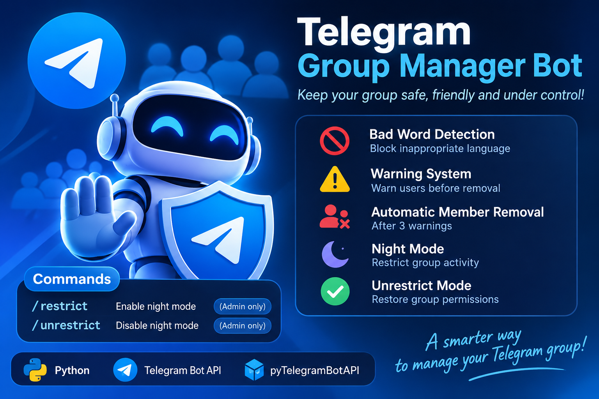

<p align="center">
  
</p>

# Telegram Group Manager Bot

A Telegram group management bot developed using Python and the `pyTelegramBotAPI` library. The bot provides basic group moderation features, including bad-word detection, warning management, member removal, and group-wide restriction controls.

## Features

- **Bad Word Detection:** Automatically checks incoming messages against a predefined list of prohibited words.
- **Warning System:** Issues warnings to users who use prohibited words.
- **Automatic Member Removal:** Removes users after receiving more than three warnings.
- **Admin Authorization:** Restriction commands are available only to group administrators and the group owner.
- **Night Mode:** Temporarily disables messaging permissions and other activities for group members.
- **Unrestrict Mode:** Restores messaging and other group permissions.
- **Logging:** Uses Python logging to record bot activities.

## Commands

| Command | Description | Permission |
|---|---|---|
| `/restrict` | Disables group members' messaging permissions (Night Mode). | Admin only |
| `/unrestrict` | Restores group permissions. | Admin only |

## Requirements

- Python 3.11+
- Telegram Bot Token
- `pyTelegramBotAPI`

## Installation

1. Clone the repository:

```bash
git clone https://github.com/YOUR_USERNAME/YOUR_REPOSITORY.git
```

2. Navigate to the project directory:

```bash
cd YOUR_REPOSITORY
```

3. Install the required library:

```bash
pip install pyTelegramBotAPI
```

## Configuration

Set your Telegram Bot API token in the source code:

```python
API_TOKEN = 'YOUR_BOT_TOKEN'
```

You can also customize the prohibited words list:

```python
badwordlist = ["badword1", "badword2", "badword3"]
```

## Run the Bot

Start the bot using:

```bash
python bot.py
```

## Permissions

To use the moderation features, make sure:

- The bot is added to your Telegram group.
- The bot is granted administrator privileges.
- The bot has permission to restrict and remove group members.

## Technologies

- Python
- pyTelegramBotAPI
- Telegram Bot API
- Logging

## Future Improvements

- Persistent warning storage using a database.
- Configurable warning limits.
- Better word detection and text normalization.
- Individual user restriction instead of changing permissions for the entire group.
- Environment variables for secure token management.

## License

This project is open-source and available for educational and development purposes.
